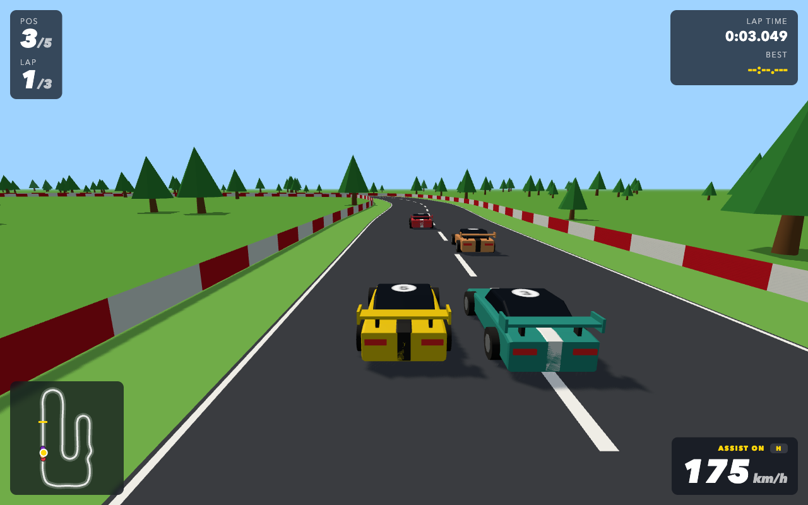

# Low-Poly GP

A low-poly 3D racing game for the browser, built with Three.js. Race three laps against four AI drivers, starting from the back of the grid.

**Play:** https://vanmanh49.github.io/low-poly-gp/



## Controls

| Key | Action |
| --- | --- |
| W / ↑ | Accelerate |
| S / ↓ | Brake / reverse |
| A D / ← → | Steer |
| Space | Handbrake (drift) |
| H | Steering assist on / off |
| R | Restart race |
| Enter | Start |

## Development

```bash
npm install
npm run dev     # local dev server
npm test        # unit + headless race tests
npm run build   # production build in dist/
```

The simulation in `src/sim/` (track, car physics, collisions, race rules, AI) is pure JavaScript with no rendering dependencies and is tested headlessly. `src/render/` and `src/ui/` draw it with Three.js and DOM overlays. Handling and AI tuning live in `src/sim/params.js`.
